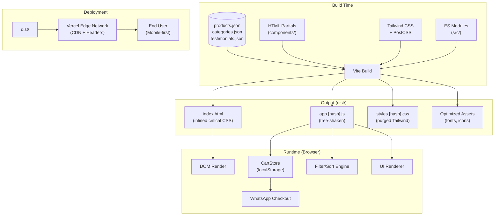
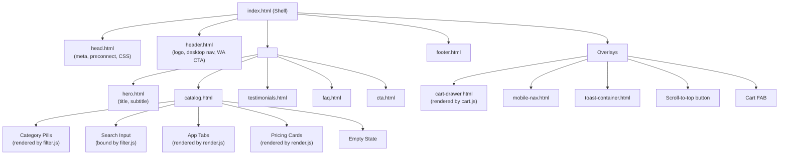
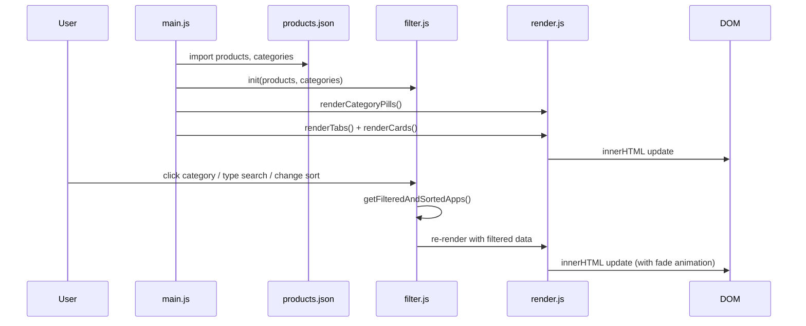
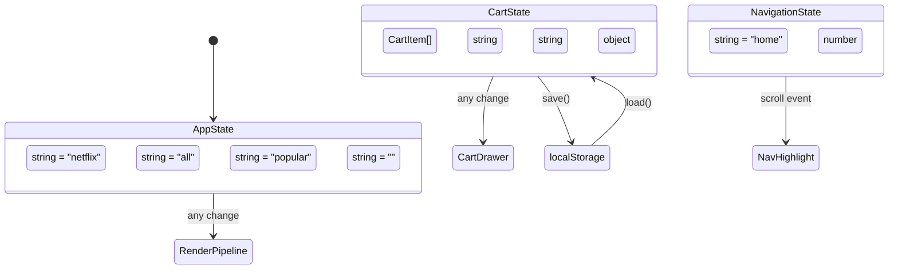
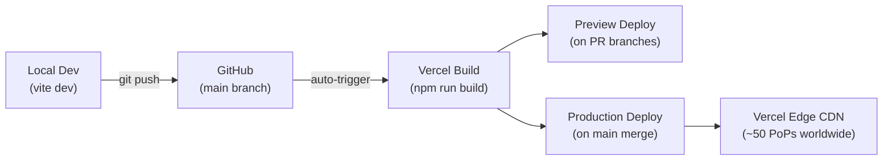

# ARCHITECTURE.md — Cozu Store Redesign

> **Version:** 2.0  
> **Last updated:** November 2026  
> **Status:** Approved for implementation  

---

## Table of Contents

1. [System Overview](#1-system-overview)
2. [Technology Stack](#2-technology-stack)
3. [Project Structure](#3-project-structure)
4. [Data Architecture](#4-data-architecture)
5. [Component Architecture](#5-component-architecture)
6. [State Management](#6-state-management)
7. [Build Pipeline](#7-build-pipeline)
8. [Performance Budget](#8-performance-budget)
9. [SEO Strategy](#9-seo-strategy)
10. [Analytics & Tracking](#10-analytics--tracking)
11. [Deployment Pipeline](#11-deployment-pipeline)
12. [Security Considerations](#12-security-considerations)
13. [Future Roadmap](#13-future-roadmap)

---

## 1. System Overview

### High-Level Architecture



### Design Decisions & Rationale

| Decision | Rationale | Alternative Rejected |
|----------|-----------|---------------------|
| **Vite + vanilla JS** (no framework) | Site is a single-page catalog with ~4 products. React/Vue/Astro adds 30-100kb+ runtime for zero benefit. Current vanilla approach works — just needs modularization. | Next.js, Astro, Svelte |
| **Tailwind CSS with build** | Current CDN loads 300kb+. Build-time purge → ~8-15kb CSS. | Keep CDN, switch to plain CSS |
| **JSON data files** | Products change rarely. JSON files are editable by non-developers, no CMS overhead. | Headless CMS, Markdown/YAML |
| **ES Modules** | Native browser `import/export`, Vite handles bundling. No class hierarchy needed. | TypeScript (overkill for 4 products), CommonJS |
| **Keep on Vercel** | Already deployed, free tier sufficient, zero-config static hosting. | Netlify, Cloudflare Pages |

### What Changes vs. What Stays

| Stays the Same | Changes |
|----------------|---------|
| Vanilla JS (no framework) | Single file → ES Modules |
| WhatsApp checkout flow | Hardcoded data → JSON files |
| CartStore with localStorage | Tailwind CDN → built CSS |
| Hash routing | Monolithic HTML → partials (build-time includes) |
| Same UI/UX design | No build → Vite pipeline |

---

## 2. Technology Stack

| Layer | Current | Redesign |
|-------|---------|----------|
| **Build Tool** | None | **Vite 6.x** |
| **CSS** | Tailwind CDN (`<script>`) + custom CSS | **Tailwind CSS 4.x** via PostCSS (purged) |
| **JS** | Single `script.js` (1575 lines) | **ES Modules** split by concern |
| **Fonts** | Google Fonts CDN (Plus Jakarta Sans, Inter) | Same, with `font-display: swap` + preconnect |
| **Icons** | Font Awesome CDN (6.5.1) | Same CDN, or subset via `@fortawesome/fontawesome-svg-core` (Phase 2) |
| **Deployment** | Vercel (static) | Vercel (static) with headers config |
| **Package Manager** | None | **npm** |

### Why Not TypeScript?

The entire JS surface is ~15 functions and 1 CartStore object. TypeScript's compile step and type definitions add friction with zero safety payoff at this scale. JSDoc type comments suffice.

---

## 3. Project Structure

```
cozu-store/
├── public/                    # Static assets (copied as-is)
│   ├── favicon.ico
│   ├── og-image.png           # Open Graph image (1200×630)
│   └── robots.txt
│
├── src/
│   ├── data/                  # Product & content data
│   │   ├── products.json      # All apps, plans, pricing
│   │   ├── categories.json    # Category definitions
│   │   └── testimonials.json  # Customer testimonials
│   │
│   ├── modules/               # ES Module JS files
│   │   ├── cart.js             # CartStore + localStorage logic
│   │   ├── checkout.js         # WhatsApp message formatting + checkout
│   │   ├── filter.js           # Category filter + search + sort engine
│   │   ├── render.js           # DOM rendering (tabs, cards, pills, drawer)
│   │   ├── navigation.js       # Scroll spy, hash routing, smooth scroll
│   │   ├── toast.js            # Toast notification system
│   │   └── utils.js            # Shared helpers (parsePrice, formatRupiah, escapeHtml, hexToRgba)
│   │
│   ├── styles/
│   │   ├── main.css            # Tailwind directives + custom CSS
│   │   └── animations.css      # Keyframes (fadeIn, toast, badge, drawer)
│   │
│   ├── partials/               # HTML fragments (injected at build time via vite-plugin-handlebars or manual concat)
│   │   ├── head.html           # <head> meta, preconnects, CSS link
│   │   ├── header.html         # Sticky desktop header + nav
│   │   ├── hero.html           # Hero section
│   │   ├── catalog.html        # Category pills + search + tabs + pricing grid
│   │   ├── testimonials.html   # Testimonial carousel
│   │   ├── faq.html            # FAQ accordion
│   │   ├── cta.html            # Contact/request CTA banner
│   │   ├── footer.html         # Footer
│   │   ├── cart-drawer.html    # Cart slide-over drawer
│   │   ├── mobile-nav.html     # Mobile bottom navigation dock
│   │   └── toast-container.html
│   │
│   └── main.js                # Entry point: imports modules, calls initCozuStore()
│
├── index.html                 # Root HTML shell (includes partials)
├── tailwind.config.js         # Tailwind config (colors, fonts, extend)
├── postcss.config.js          # PostCSS: tailwindcss + autoprefixer
├── vite.config.js             # Vite config
├── package.json
├── vercel.json                # Vercel deployment config (headers, redirects)
├── .gitignore
└── README.md
```

### File Naming Conventions

- **Data files:** `kebab-case.json`
- **JS modules:** `kebab-case.js`, one default export per file
- **CSS files:** `kebab-case.css`
- **HTML partials:** `kebab-case.html`
- No index barrel files — direct imports only

---

## 4. Data Architecture

### Product Data Schema (`src/data/products.json`)

```jsonc
[
  {
    "id": "netflix",                    // Unique slug, used as URL hash
    "name": "Netflix",                  // Display name
    "category": "streaming",            // Must match categories.json id
    "popularityScore": 100,             // Higher = shown first in default sort
    "icon": "fa-solid fa-play",         // Font Awesome class
    "color": "#E50914",                 // Brand color (hex)
    "plans": [
      {
        "name": "Sharing 1 Profile",    // Plan display name
        "bestSeller": false,            // Show "Paling Laris" badge
        "durations": {
          "daily": {                    // Key: "daily" | "weekly" | "monthly"
            "price": "Rp 6.000",        // Display price string (Indonesian format)
            "description": "Cocok untuk coba-coba singkat & nobar harian.",
            "features": [               // Bullet-point feature list
              "Ultra HD 4K",
              "1 User / 1 Profile",
              "Login 1 Device (Tidak boleh pindah device)",
              "Less Limit",
              "Garansi aktivasi"
            ]
          }
        }
      }
    ],
    // Optional: app-specific checkout fields
    "checkoutFields": [
      { "key": "netflixPhone", "label": "Nomor Customer", "type": "tel", "required": true },
      { "key": "netflixDevice", "label": "Device & Merk Lengkap", "type": "text", "required": true },
      { "key": "netflixLocation", "label": "Lokasi / Kota", "type": "text", "required": true }
    ]
  }
]
```

### Categories Schema (`src/data/categories.json`)

```json
[
  { "id": "all", "name": "Semua Aplikasi", "icon": "fa-solid fa-layer-group" },
  { "id": "streaming", "name": "Streaming Video", "icon": "fa-solid fa-play" },
  { "id": "design", "name": "Desain & Editing", "icon": "fa-solid fa-palette" },
  { "id": "music", "name": "Musik & Audio", "icon": "fa-solid fa-music" },
  { "id": "productivity", "name": "AI & Produktivitas", "icon": "fa-solid fa-brain" }
]
```

### Testimonials Schema (`src/data/testimonials.json`)

```json
[
  {
    "name": "Yuppy",
    "initials": "YP",
    "color": "red",
    "text": "pelayannya cepett bgt dan ngga ribet buat loginnya...",
    "verified": true
  }
]
```

### Cart State Schema (localStorage `cozu_cart_data_v1`)

```jsonc
{
  "items": [
    {
      "id": "netflix-sharing-1-profile-monthly",   // Generated composite key
      "appId": "netflix",
      "appName": "Netflix",
      "appIcon": "fa-solid fa-play",
      "appColor": "#E50914",
      "planName": "Sharing 1 Profile",
      "durationKey": "monthly",
      "durationLabel": "Bulanan",
      "rawPrice": "Rp 40.000",
      "unitPrice": 40000,                           // Parsed integer
      "quantity": 1                                  // 1–99
    }
  ],
  "buyerName": "",
  "buyerNotes": "",
  "extraData": {
    "netflixPhone": "",
    "netflixDevice": "",
    "netflixLocation": "",
    "canvaEmail": "",
    "bstationEmail": "",
    "capcutEmail": ""
  }
}
```

### How to Add/Edit Products

1. Edit `src/data/products.json`
2. Add the new app object following the schema above
3. If the app has a new category, add it to `src/data/categories.json`
4. If the app needs custom checkout fields (email, phone, device), add `checkoutFields` array
5. Commit → Vercel auto-deploys

No code changes needed for price updates, new plans, or new apps within existing categories.

---

## 5. Component Architecture

### Component Hierarchy



### Component Contracts (Module Interfaces)

```javascript
// src/modules/cart.js
export const CartStore = {
  items: [],
  init(),                              // Load from localStorage
  addItem(product),                    // product: {appId, planName, price, durationKey, durationLabel}
  removeItem(itemId),                  // itemId: composite string
  updateQuantity(itemId, delta),       // delta: +1 or -1
  clearCart(),
  getTotalCount() → number,
  getTotalPrice() → number,
  syncUI()                             // Updates all cart-related DOM
};

// src/modules/filter.js
export function getFilteredAndSortedApps(products, { category, searchQuery, sortBy }) → App[]
export function setCategory(catId)
export function resetAllFilters()

// src/modules/render.js
export function renderTabs(container, apps, currentAppId, onSelect)
export function renderCards(container, app, CartStore)
export function renderCategoryPills(container, categories, products, activeCat, onSelect)
export function renderCartDrawer(CartStore)

// src/modules/checkout.js
export function formatStructuredWhatsAppMessage(items, buyerName, notes, extraData, orderCode) → string
export function checkoutWhatsAppCart(CartStore)
export function directBuy(appId, planName, price, durationKey, durationLabel, CartStore)

// src/modules/navigation.js
export function initNavbarNavigation(sectionIds)
export function handleHashRoute(products)
export function initScrollToTop()

// src/modules/toast.js
export function showToast(title, message, type)
export function dismissToast(toastId)

// src/modules/utils.js
export function parsePrice(priceStr) → number
export function formatRupiah(num) → string
export function escapeHtml(str) → string
export function hexToRgba(hex, alpha) → string
export function getIndonesianDate(date) → string
```

### Rendering Pipeline



---

## 6. State Management

### State Overview

All state is **module-scoped variables** — no global `window` pollution.



### State Flow Rules

1. **Filter state** (`activeCategory`, `searchQuery`, `activeSort`) → in-memory only, resets on page reload. Intentional: users expect fresh catalog view each visit.
2. **Cart state** → persisted to `localStorage` under key `cozu_cart_data_v1`. Survives reload and revisits.
3. **Navigation state** → derived from scroll position, not stored. Hash changes are ephemeral routing.
4. **Brand theme** (`--brand-color` CSS var) → derived from `currentApp`, applied via `document.documentElement.style.setProperty()`.

### localStorage Strategy

| Key | Value | TTL |
|-----|-------|-----|
| `cozu_cart_data_v1` | JSON: `{ items, buyerName, buyerNotes, extraData }` | Permanent (until user clears cart or browser data) |

**Error handling:** If `localStorage` is unavailable (private browsing, quota exceeded), CartStore falls back to in-memory mode silently. Cart works for the session but doesn't persist.

**Migration:** If schema changes in future, bump the key to `cozu_cart_data_v2` and add a migration function that reads v1 and writes v2 on first load.

---

## 7. Build Pipeline

### Vite Configuration (`vite.config.js`)

```javascript
import { defineConfig } from 'vite';

export default defineConfig({
  root: '.',
  publicDir: 'public',
  build: {
    outDir: 'dist',
    emptyOutDir: true,
    target: 'es2020',
    minify: 'terser',
    rollupOptions: {
      input: 'index.html'
    },
    // Single chunk — total JS is <20kb, splitting adds latency
    cssMinify: true
  },
  css: {
    postcss: './postcss.config.js'
  }
});
```

### PostCSS Configuration (`postcss.config.js`)

```javascript
export default {
  plugins: {
    '@tailwindcss/postcss': {}
  }
};
```

### Tailwind Configuration (`tailwind.config.js`)

```javascript
/** @type {import('tailwindcss').Config} */
export default {
  content: [
    './index.html',
    './src/**/*.{js,html}'
  ],
  theme: {
    extend: {
      fontFamily: {
        sans: ['"Plus Jakarta Sans"', 'Inter', 'system-ui', 'sans-serif']
      },
      colors: {
        brand: 'var(--brand-color)',
        'brand-soft': 'var(--brand-color-bg)'
      }
    }
  },
  plugins: []
};
```

### Build Commands

```json
{
  "scripts": {
    "dev": "vite",
    "build": "vite build",
    "preview": "vite preview"
  }
}
```

### Asset Optimization

| Asset Type | Strategy |
|-----------|----------|
| CSS | Tailwind purge + cssnano minification via Vite |
| JS | Terser minification, tree-shaking dead code |
| Fonts | Preconnect to Google Fonts, `font-display: swap` |
| Images (future) | If product images added: `vite-plugin-imagemin` or Vercel Image Optimization |

---

## 8. Performance Budget

### Target Metrics

| Metric | Target | Current (estimated) |
|--------|--------|-------------------|
| **LCP** (Largest Contentful Paint) | < 1.5s | ~2.5s (Tailwind CDN blocks render) |
| **FID** (First Input Delay) | < 50ms | ~80ms (single large JS file) |
| **CLS** (Cumulative Layout Shift) | < 0.05 | ~0.02 (already good) |
| **TTI** (Time to Interactive) | < 2.0s | ~3.0s |
| **TTFB** | < 200ms | ~100ms (Vercel is fast) |

### Bundle Size Targets

| Asset | Current | Target | Reduction |
|-------|---------|--------|-----------|
| **CSS** | ~300kb (Tailwind CDN, uncompressed) | < 15kb gzipped | 95% |
| **JS** | ~62kb (script.js, unminified) | < 18kb gzipped | 70% |
| **HTML** | ~34kb | ~30kb | 12% |
| **Total transfer** | ~400kb+ | < 80kb gzipped | 80% |

### Font Optimization

```html
<!-- Preconnect for faster font loading -->
<link rel="preconnect" href="https://fonts.googleapis.com">
<link rel="preconnect" href="https://fonts.gstatic.com" crossorigin>

<!-- Load only needed weights -->
<link href="https://fonts.googleapis.com/css2?family=Plus+Jakarta+Sans:wght@500;600;700;800&display=swap" rel="stylesheet">
```

Drop Inter (Plus Jakarta Sans covers all use cases). Drop weight 400 if not used in body text — the lightest used weight is 500 (font-medium).

---

## 9. SEO Strategy

### Meta Tags (`<head>`)

```html
<title>Cozu Store — Jual Akun Premium Netflix, Canva, Bstation, CapCut Murah & Bergaransi</title>
<meta name="description" content="Beli akun premium Netflix, Canva, Bstation, dan CapCut harga termurah. Proses 5-15 menit, garansi full, pembayaran via QRIS & e-wallet. Terpercaya sejak 2024.">
<meta name="keywords" content="akun premium murah, netflix sharing, canva pro murah, bstation premium, capcut pro, jual akun premium bergaransi">
<link rel="canonical" href="https://cozu-store.vercel.app/">
<meta name="robots" content="index, follow">
<meta name="author" content="Cozu Store">
```

### Open Graph & Social

```html
<!-- Open Graph -->
<meta property="og:type" content="website">
<meta property="og:url" content="https://cozu-store.vercel.app/">
<meta property="og:title" content="Cozu Store — Akun Premium Murah & Bergaransi">
<meta property="og:description" content="Netflix, Canva, Bstation, CapCut premium. Harga mulai Rp 4.000. Garansi full, proses kilat.">
<meta property="og:image" content="https://cozu-store.vercel.app/og-image.png">
<meta property="og:image:width" content="1200">
<meta property="og:image:height" content="630">
<meta property="og:locale" content="id_ID">

<!-- Twitter Card -->
<meta name="twitter:card" content="summary_large_image">
<meta name="twitter:title" content="Cozu Store — Akun Premium Murah & Bergaransi">
<meta name="twitter:description" content="Netflix, Canva, Bstation, CapCut premium. Harga mulai Rp 4.000.">
<meta name="twitter:image" content="https://cozu-store.vercel.app/og-image.png">
```

### Structured Data (JSON-LD)

```html
<script type="application/ld+json">
{
  "@context": "https://schema.org",
  "@type": "Store",
  "name": "Cozu Store",
  "description": "Penyedia akun premium Netflix, Canva, Bstation, CapCut dengan harga termurah dan garansi full.",
  "url": "https://cozu-store.vercel.app",
  "telephone": "+6287862481038",
  "address": {
    "@type": "PostalAddress",
    "addressCountry": "ID"
  },
  "priceRange": "Rp 4.000 - Rp 45.000",
  "openingHours": "Mo-Su 08:00-22:00",
  "sameAs": [
    "https://wa.me/6287862481038"
  ],
  "hasOfferCatalog": {
    "@type": "OfferCatalog",
    "name": "Akun Premium Digital",
    "itemListElement": [
      {
        "@type": "Offer",
        "itemOffered": {
          "@type": "Service",
          "name": "Netflix Premium Sharing"
        },
        "priceCurrency": "IDR",
        "price": "6000",
        "priceValidUntil": "2027-12-31"
      },
      {
        "@type": "Offer",
        "itemOffered": {
          "@type": "Service",
          "name": "Canva Pro"
        },
        "priceCurrency": "IDR",
        "price": "4000",
        "priceValidUntil": "2027-12-31"
      }
    ]
  }
}
</script>
```

### Sitemap (`public/sitemap.xml`)

```xml
<?xml version="1.0" encoding="UTF-8"?>
<urlset xmlns="http://www.sitemaps.org/schemas/sitemap/0.9">
  <url>
    <loc>https://cozu-store.vercel.app/</loc>
    <lastmod>2026-11-11</lastmod>
    <changefreq>weekly</changefreq>
    <priority>1.0</priority>
  </url>
</urlset>
```

### Robots.txt (`public/robots.txt`)

```
User-agent: *
Allow: /
Sitemap: https://cozu-store.vercel.app/sitemap.xml
```

---

## 10. Analytics & Tracking

### Events to Track

| Event | Trigger | Data |
|-------|---------|------|
| `page_view` | Page load | referrer, device type |
| `view_catalog` | Scroll to `#layanan` | — |
| `filter_category` | Click category pill | category_id |
| `search_product` | Type in search (debounced 500ms) | query string |
| `sort_change` | Change sort dropdown | sort_key |
| `view_product` | Click app tab | app_id |
| `add_to_cart` | Click "+ Keranjang" | app_id, plan_name, price, duration |
| `remove_from_cart` | Remove item from drawer | item_id |
| `begin_checkout` | Click "Pesan via WhatsApp" | total_items, total_price |
| `checkout_redirect` | WhatsApp URL opened | order_code, total_price |
| `direct_buy` | Click "Beli Langsung" | app_id, plan_name, price |
| `view_faq` | Open FAQ accordion | faq_question_index |
| `contact_admin` | Click any WhatsApp CTA link | source (header/footer/cta) |

### Recommended Tool: **Umami** (self-hosted) or **Google Analytics 4**

For a small store, **Umami** is ideal:
- Privacy-friendly (GDPR/no cookie banner needed)
- Self-hosted free tier on Vercel/Railway
- Lightweight (~1kb script)
- No impact on performance budget

**Implementation:**

```html
<!-- Before </head> -->
<script defer src="https://your-umami.vercel.app/script.js" data-website-id="xxx"></script>
```

Custom events via `umami.track('event_name', { key: value })`.

If Google Analytics 4 is preferred:

```html
<script async src="https://www.googletagmanager.com/gtag/js?id=G-XXXXXXXX"></script>
<script>
  window.dataLayer = window.dataLayer || [];
  function gtag(){dataLayer.push(arguments);}
  gtag('js', new Date());
  gtag('config', 'G-XXXXXXXX');
</script>
```

---

## 11. Deployment Pipeline

### Vercel Configuration (`vercel.json`)

```json
{
  "buildCommand": "npm run build",
  "outputDirectory": "dist",
  "framework": null,
  "headers": [
    {
      "source": "/(.*)",
      "headers": [
        { "key": "X-Content-Type-Options", "value": "nosniff" },
        { "key": "X-Frame-Options", "value": "DENY" },
        { "key": "X-XSS-Protection", "value": "1; mode=block" },
        { "key": "Referrer-Policy", "value": "strict-origin-when-cross-origin" },
        { "key": "Permissions-Policy", "value": "camera=(), microphone=(), geolocation=()" }
      ]
    },
    {
      "source": "/assets/(.*)",
      "headers": [
        { "key": "Cache-Control", "value": "public, max-age=31536000, immutable" }
      ]
    },
    {
      "source": "/(.*).html",
      "headers": [
        { "key": "Cache-Control", "value": "public, max-age=0, must-revalidate" }
      ]
    }
  ],
  "redirects": [
    { "source": "/index.html", "destination": "/", "statusCode": 301 }
  ]
}
```

### Environment Variables

| Variable | Purpose | Where Set |
|----------|---------|-----------|
| `VITE_WA_NUMBER` | WhatsApp admin number | Vercel env vars |
| `VITE_ANALYTICS_ID` | Umami/GA4 tracking ID | Vercel env vars |
| `VITE_SITE_URL` | Canonical URL for SEO | Vercel env vars |

Access in code: `import.meta.env.VITE_WA_NUMBER`

### Deployment Flow



### Preview Deployments

- Every push to a non-`main` branch creates a preview URL
- Share preview links with stakeholders before merging
- Preview URLs format: `cozu-store-<hash>-<username>.vercel.app`

---

## 12. Security Considerations

### Content Security Policy (CSP)

Add via `vercel.json` headers:

```json
{
  "key": "Content-Security-Policy",
  "value": "default-src 'self'; script-src 'self' https://cdn.tailwindcss.com https://www.googletagmanager.com 'unsafe-inline'; style-src 'self' https://fonts.googleapis.com https://cdnjs.cloudflare.com 'unsafe-inline'; font-src 'self' https://fonts.gstatic.com https://cdnjs.cloudflare.com; img-src 'self' data:; connect-src 'self' https://www.google-analytics.com; frame-ancestors 'none'"
}
```

> After migration to built Tailwind CSS, remove `https://cdn.tailwindcss.com` from `script-src`.

### Input Sanitization

**Already implemented in current code:**
- `escapeHtml()` used on all user-generated strings before DOM insertion
- Cart item data is sanitized before rendering

**Additional hardening:**
- Validate `tel` and `email` fields client-side before WhatsApp checkout
- Limit field lengths: name ≤ 100 chars, notes ≤ 500 chars, email ≤ 254 chars
- Price strings are parsed with `parsePrice()` which strips all non-numeric characters

### External Link Safety

All external links (`wa.me`, CDN) already use:
```html
target="_blank" rel="noopener noreferrer"
```

### WhatsApp Redirect Safety

Current `window.open()` for WhatsApp can fail silently if:
- Popup blocker is active
- User is on a browser without WhatsApp support

**Fix:** Add fallback:

```javascript
function safeOpenWhatsApp(url) {
  const newWindow = window.open(url, '_blank');
  if (!newWindow || newWindow.closed) {
    // Fallback: navigate current tab
    window.location.href = url;
  }
}
```

### localStorage Security

- No sensitive data (passwords, tokens) stored
- Cart data is non-critical — worst case: user loses cart items
- `JSON.parse()` wrapped in try/catch to prevent corrupted data crashes

---

## 13. Future Roadmap

### Phase 2: Enhanced UX (1-2 months after launch)

| Feature | Effort | Impact |
|---------|--------|--------|
| **Product images/logos** (app icons as SVG/PNG instead of Font Awesome) | Low | Medium |
| **Sort dropdown** in catalog toolbar | Low | Medium |
| **Font Awesome subsetting** (only load used icons, save ~100kb) | Medium | High (perf) |
| **PWA support** (service worker, offline page, install prompt) | Medium | Medium |
| **Dark mode toggle** | Low | Low |
| **WhatsApp Business API** (automated order confirmation) | High | High |

### Phase 3: Growth Features (3-6 months)

| Feature | Effort | Impact |
|---------|--------|--------|
| **Multi-page** (separate `/products/netflix` pages for SEO) | Medium | High (SEO) |
| **Admin panel** (simple dashboard to update products.json via API) | High | High (ops) |
| **Promo/coupon system** (discount codes in cart) | Medium | Medium |
| **Customer accounts** (order history via WhatsApp number lookup) | High | Medium |
| **Payment gateway integration** (Midtrans/Xendit QRIS) | High | High |

### Migration Path to Full Framework

If/when Cozu Store outgrows vanilla JS (multiple pages, dynamic content, admin panel), the migration path is:

1. **Astro** (recommended): Drop-in for current architecture. Keep existing HTML/CSS/JS as `.astro` components. Zero JS shipped by default. JSON data files become `Astro.glob()` imports. Only cart module ships as client-side island.

2. **Next.js** (if full SSR needed): More migration effort. Rewrite components as React. Products from JSON → `getStaticProps()`. Cart → React state + localStorage sync.

**Decision trigger:** Migrate when you need ≥3 of: server-side data fetching, authentication, dynamic routing, API routes, or international i18n.

---

## Appendix A: Current Codebase Inventory

| File | Lines | Size | Purpose |
|------|-------|------|---------|
| `index.html` | 802 | 34kb | Full page markup (header, hero, catalog, testimonials, FAQ, footer, cart drawer, mobile nav, toasts) |
| `script.js` | 1,575 | 62kb | All JS: product data (161 lines), filter engine (43 lines), rendering (230 lines), cart system (175 lines), checkout/WA formatting (100 lines), toast system (45 lines), navigation (80 lines), dynamic form fields (280 lines), utilities (40 lines), init (25 lines) |
| `styles.css` | 332 | 7kb | Custom CSS: variables, animations, component styles, responsive overrides |
| `test_cart.js` | ~500 | 22kb | Cart unit tests (basic) |

### Module Extraction Map

This table shows where each section of the current `script.js` maps to in the new structure:

| Current `script.js` Lines | Content | New Module |
|---------------------------|---------|------------|
| 1–161 | `appsData`, `categoriesData` arrays | `src/data/products.json`, `src/data/categories.json` |
| 163–174 | Global state variables | `src/modules/filter.js` (module-scoped) |
| 176–298 | `durationLabels`, `getMinPrice`, `getMaxPrice`, `hexToRgba`, `updateBrandTheme`, `getFilteredAndSortedApps` | `src/modules/utils.js` + `src/modules/filter.js` |
| 300–378 | `renderCategoryPills`, `setCategory`, `updateAppView`, `resetAllFilters` | `src/modules/filter.js` + `src/modules/render.js` |
| 380–533 | `renderTabs`, `setApp`, `renderCards` | `src/modules/render.js` |
| 535–562 | `orderNow`, `scrollTestimonials`, `scrollToTop` | `src/modules/checkout.js`, `src/modules/navigation.js` |
| 564–627 | `initScrollToTop`, `initSearch`, `resetSearch` | `src/modules/navigation.js`, `src/modules/filter.js` |
| 629–837 | CartStore object (load, save, addItem, removeItem, updateQuantity, clearCart, syncUI) | `src/modules/cart.js` |
| 838–901 | `addToCart`, `directBuy`, `triggerBadgeAnimation`, `updateCartBadge` | `src/modules/cart.js` |
| 902–965 | `openCartDrawer`, `closeCartDrawer`, `toggleCartDrawer` | `src/modules/render.js` |
| 967–1263 | `renderDynamicAppFields`, `renderCartDrawer`, `clearAllCart` | `src/modules/render.js` |
| 1265–1399 | `formatStructuredWhatsAppMessage`, `checkoutWhatsAppCart` | `src/modules/checkout.js` |
| 1401–1448 | `showToast`, `dismissToast` | `src/modules/toast.js` |
| 1450–1575 | Navigation scroll spy, hash routing, init | `src/modules/navigation.js`, `src/main.js` |

## Appendix B: Quick Reference Commands

```bash
# Install dependencies
npm install

# Start dev server (hot reload)
npm run dev

# Build for production
npm run build

# Preview production build locally
npm run preview

# Deploy (auto via Vercel Git integration, or manual)
npx vercel --prod
```
